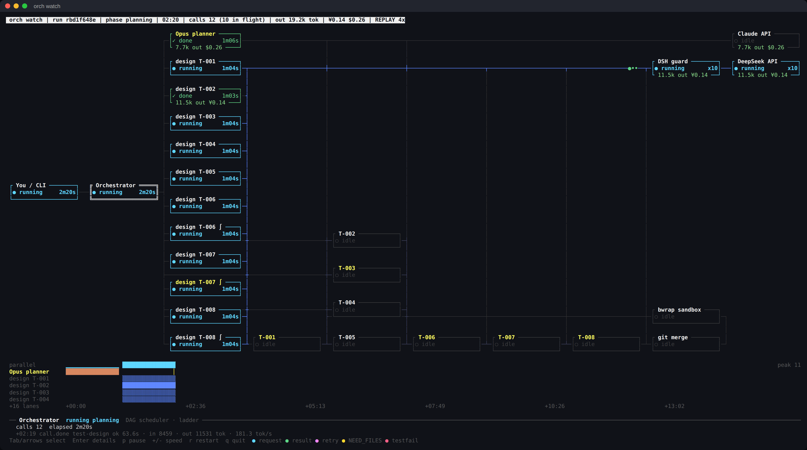
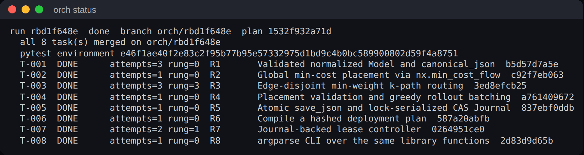
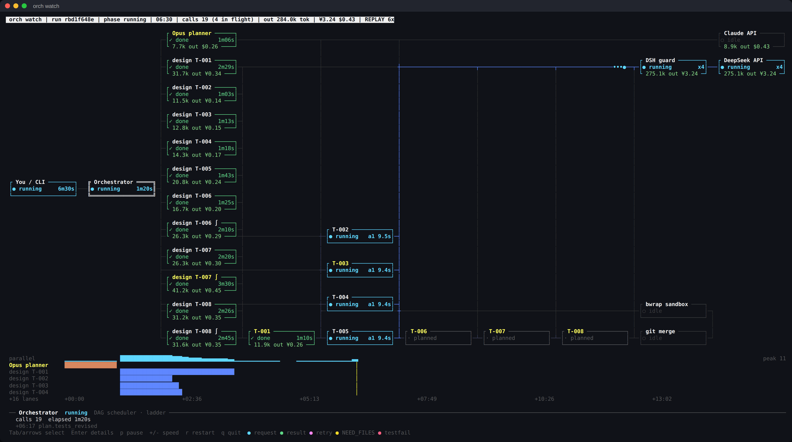
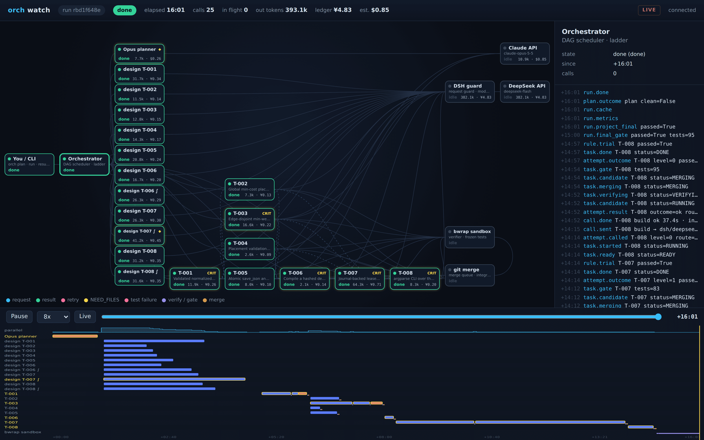
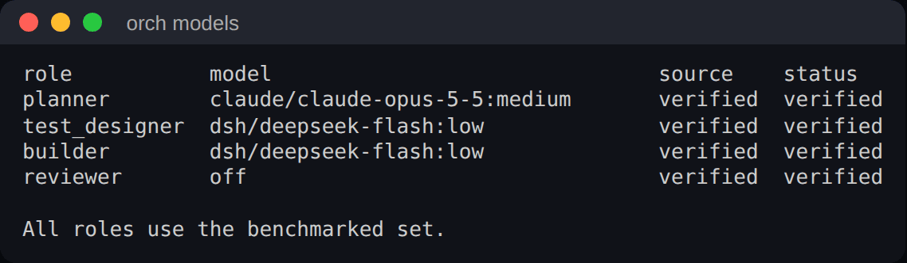

# orch

**English** · [简体中文](README.zh-CN.md)

**Test-gated build orchestration for coding agents.** A strong model plans, cheap models
build in parallel, and only what frozen tests prove ever reaches your code.

[](https://github.com/Orchestragent/orchestragent/actions/workflows/ci.yml)
[](LICENSE)




*`orch watch` during a real run on NetworkX (116k lines): the planner has finished, ten
test shards are being written in parallel, and builders wait for their frozen tests.*

## Why orch

- **Pay a fraction of a single frontier agent.** The expensive model only plans; tests and
  code come from a cheap model running in parallel. Measured runs cost **½ to ⅕** of a
  native Claude Opus 5.5 agent at high effort doing the same job ([numbers below](#benchmarks)).
- **Correct by construction, not by hope.** Every task gets independent tests that are
  frozen *before* any implementation exists. A task merges only when its tests pass, inside
  an OS sandbox with no network. Your checked-out branch is never touched: you review one
  result branch.
- **Your models, your accounts.** Bring your own CLI subscription (Claude Code, Codex,
  Cursor) or your own API key (Anthropic, DeepSeek, OpenAI, Qwen, OpenRouter, a local
  Ollama — any OpenAI-compatible endpoint). Swap the model behind any role.
- **Lives where you work.** A CLI with a live terminal view, a macOS app, and an
  [MCP](https://modelcontextprotocol.io) server so Claude Code, Cursor or Claude Desktop can
  hand a whole multi-module build to orch and keep going.

## How it works

1. **Plan.** The planner (default: Claude Opus 5.5) splits the spec into tasks with explicit
   boundaries, owned files and interfaces.
2. **Freeze tests.** For every task, and every task that integrates others, the test
   designer (default: DeepSeek V4.1 Flash) writes independent tests. They are linted, run
   against stubs, required to assert behaviour decisively, and frozen.
3. **Build in parallel.** Builders implement tasks concurrently in isolated git worktrees;
   every test run happens in an OS sandbox (bubblewrap + seccomp on Linux, Seatbelt on
   macOS).
4. **Merge only what passes.** A task merges onto `orch/<run_id>` only when its frozen tests
   pass. Failures climb a ladder — retry with the failure, sampled candidates, a stronger
   repair, a replan — instead of starting over. A final gate runs your project's own suite.

Every model call, token, cache hit, cost and state change is recorded, so a run can be
resumed, audited (`orch audit`), traced back from any line (`orch trace`, `orch why`) and
watched live (`orch watch`).

## Install

```sh
curl -fsSL https://raw.githubusercontent.com/Orchestragent/orchestragent/main/install.sh | sh
```

The installer (macOS and Linux) checks git and the sandbox, installs
[uv](https://astral.sh/uv) and orch as an isolated tool, offers to store your DeepSeek key,
registers `orch mcp` with Claude Code / Claude Desktop / Cursor when present, offers
Orch.app on macOS, and ends with `orch doctor`. `sh install.sh --dry-run` shows every step.

Other ways:

```sh
brew install orchestragent/tap/orchestragent       # macOS, with zsh/bash/fish completion
uv tool install "orchestragent[index] @ git+https://github.com/Orchestragent/orchestragent"
```

Requirements: Python 3.12+, git, and on Linux [bubblewrap](https://github.com/containers/bubblewrap)
(`apt install bubblewrap`). For the default models: [Claude Code](https://code.claude.com),
logged in with a subscription (`claude auth login`) or an Anthropic API key as Claude Code
documents it, and a DeepSeek API key (`orch keys dsh`). Anything else is optional; see
[Models](#models-bring-your-own-cli-or-key).

## Quick start

Write the requirements as numbered, testable statements — they are the authoritative input:

```markdown
# spec.md
R1. textstats.py: word_count(text: str) -> int counts whitespace-separated words;
    non-str input raises TypeError.
R2. textstats.py: top_words(text, n) returns the n most frequent lower-cased words with
    counts, ties broken alphabetically; n must be a non-negative int, else ValueError.
R3. slug.py: slugify(text) lower-cases, replaces runs of non-alphanumerics with "-",
    and strips leading/trailing "-".
```

```sh
cd your-project                  # any git repository with at least one commit
orch doctor                      # models, keys and sandbox ready?
orch plan spec.md                # plan + frozen tests; prints the run id
orch run --notify                # parallel builders, gated merges, a notification at the end
orch watch                       # in another terminal: the whole system, live
orch cost                        # tokens, cache hits and spend per task and model
git diff HEAD...orch/<run_id>    # review the result branch, then merge it yourself
```



*`orch status` after the NetworkX run above: eight tasks, each merged only after its frozen
tests passed; two needed the failure ladder (`rung`), none needed a human.*

## Use orch from your agent (MCP)

`orch mcp` is a Model Context Protocol server: your agent writes the spec, hands the build to
orch, keeps working, and reviews the branch when it is done.

```sh
orch mcp --install claude-code      # or: cursor, claude-desktop (config merged and backed up)
```

Tools: `orch_start` (plan and run in the background), `orch_wait`, `orch_status`,
`orch_report` (outcome, branch, diff stat), `orch_cost`, `orch_cancel`, `orch_doctor`.

## Watch it work



*Same run, six minutes in: every test shard is frozen, four builders work in parallel on
DeepSeek, and later tasks wait for the ones they depend on.*

- **Terminal** — `orch watch` draws the live architecture: planner, test shards, builders,
  model APIs, sandbox and merge gate, with messages moving along the edges, a timeline per
  lane and running cost. It degrades to 8 colours, monochrome, ASCII or plain text, so it
  works over any SSH session. `--replay` replays a finished run; `--once` prints a snapshot.
- **macOS** — `orch app install` adds **Orch.app**: open it, choose a project, and its live
  dashboard opens in your browser.
- **Browser** — `orch watch --web` (loopback only unless you bind elsewhere with a token);
  `--export run.html` writes a self-contained replay you can share.



*The browser view of the finished run: architecture graph, live event log, scrubbable
timeline per lane, and spend per node.*

## Models: bring your own CLI or key

orch is the architecture; the models are yours. Each role can be served by a CLI you are
logged into with your own subscription (**BYOC**) or by an API key (**BYOK**):

| provider | how | kind |
|---|---|---|
| `claude/<model>:<effort>` | Claude Code: `claude auth login`, or `ANTHROPIC_API_KEY` / Bedrock / Vertex as Claude Code documents | BYOC or BYOK |
| `codex/<model>:<effort>` | Codex CLI, logged in with your ChatGPT plan or key | BYOC or BYOK |
| `cursor/<model>` | Cursor CLI, logged in with your Cursor plan | BYOC |
| `dsh/deepseek-flash:<effort>` | DeepSeek V4.1 Flash (DSH CLI or direct API): `orch keys dsh` | BYOK |
| `<name>/<model>[:effort]` | any OpenAI-compatible API you register: OpenAI, Qwen, Moonshot, Zhipu, OpenRouter, a local Ollama or vLLM | BYOK |

```sh
orch providers add openrouter --base-url https://openrouter.ai/api/v1 --key-env OPENROUTER_API_KEY
orch providers add local --base-url http://localhost:11434/v1      # Ollama, no key needed
orch providers test openrouter some/model                           # one tiny real request
orch models set builder openrouter/some/model
orch models                                                         # what serves each role
orch models reset                                                   # back to the verified set
```

The **verified set** is what the benchmarks measured. Keep it to reproduce our results, or
swap anything:

| role | verified default | what it does |
|---|---|---|
| planner | `claude/claude-opus-5-5:medium` | splits the spec into tasks, boundaries and interfaces |
| test_designer | `dsh/deepseek-flash:low` | writes each task's frozen tests |
| builder | `dsh/deepseek-flash:low` | implements tasks against the frozen tests |
| reviewer | `off` (or `planner`, `opus-low`, `sonnet`, `sonnet-high`, `dsf`) | optional check of each test shard before freezing |



Other combinations run through the same adapters but are unverified: quality, speed and cost
may differ. `orch doctor` tells you when a custom set is active.

**Use providers within their terms.** Some consumer subscriptions do not allow automated or
third-party use; don't connect those (orch refuses the ones it knows, such as Kimi's). See
[DISCLAIMER.md](DISCLAIMER.md).

## Benchmarks

Hidden acceptance tests the models never see, cold provider caches, the same inputs for every
configuration. Full data and logs: [`docs/measurements`](docs/measurements).

**Medium feature on an existing repository** (Boltons, 18k lines, 8 hidden tests; 4
interleaved runs each):

| | acceptance | wall time (median) | cost per run |
|---|---:|---:|---:|
| Claude Opus 5.5 (high), native agent | 4/4 runs pass | 388 s | $1.42–1.84 |
| **orch** (verified set) | 4/4 runs pass | 444 s | **≈ $0.50–0.86** |

**Larger features** (8 hidden tests each; unattended from the spec to the end):

| case | native Opus 5.5 · medium | native Opus 5.5 · high | native Opus 5.5 · max | orch |
|---|---|---|---|---|
| build graph + cache + runner (Boltons, 5 modules) | – | 8/8 · 778 s · $3.32 | – | **8/8 · 511 s · $0.62** |
| rollout controller (NetworkX, 116k lines, 8 modules) | 8/8 · 677 s · $1.94 | 8/8 · 1030 s · $2.72 | did not finish in 40 min | 8/8 · 975 s · **$1.54** |
| time-expanded flows (NetworkX, 9 coupled modules) | 8/8 · 632 s · $2.33 | 8/8 · 1078 s · $3.82 | 8/8 · 2219 s · $10.29 | 7/8 · 1022 s · **$1.60** |

Where orch stands today: it is the cheapest configuration on every case, and on the
build-graph case it is also the fastest, about 5× cheaper than Opus high. On NetworkX it
is not yet the most reliable: Opus 5.5 at medium and high passed every run, while orch
reached 8/8 in 6 of its 18 runs across the configurations we tried and otherwise usually
missed one hidden requirement. That is what we are working on next. More effort did not
help the single agent either: at max, Opus took 3.5× as long as at medium, cost 4.4× as
much on time-expanded flows, and did not finish the rollout controller within 40 minutes.
Every run, including the failed and invalid ones:
[docs/measurements/2026-11-02-large-projects.md](docs/measurements/2026-11-02-large-projects.md).

## Under the hood

- `src/orchestragent/orch_run.py`: planner, test design, scheduler, failure ladder
- `orch_thin.py`, `orch_plan.py`: boundary plans, lint, frozen test shards
- `orch_build.py`, `orch_context.py`, `orch_index.py`: builder context and code index
- `platform.py`, `live_workspace.py`: sandboxed test execution
- `orch_watch*.py`: live views · `orch_mcp.py`: MCP server · `byok.py`: OpenAI-compatible
  providers · `orch_models.py`: roles · `orch_cli.py`: the CLI

Development: `uv sync && uv run pytest -q && uv run ruff check src tests && uv run mypy`.
Design notes (Chinese): [docs/ORCH.md](docs/ORCH.md).

## Security

Models only return JSON; orch alone writes files and runs commands. Generated tests run in
an OS sandbox with no network. Keys stay on your machine (macOS Keychain or a 0600 file)
and are never logged. orch sets no spending cap of its own: spend is recorded and shown by
`orch cost`, and your provider's balance or limits apply. See [SECURITY.md](SECURITY.md).

## License

Apache-2.0 ([LICENSE](LICENSE)). Using model providers through orch is subject to their
terms; see [DISCLAIMER.md](DISCLAIMER.md).
