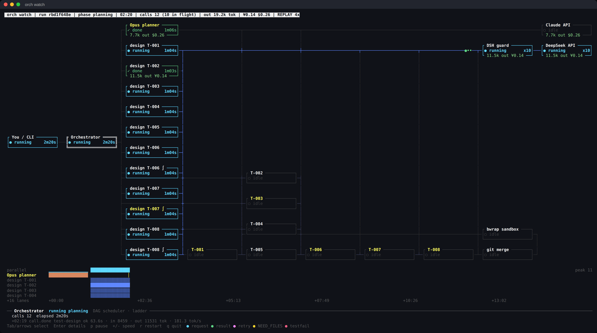
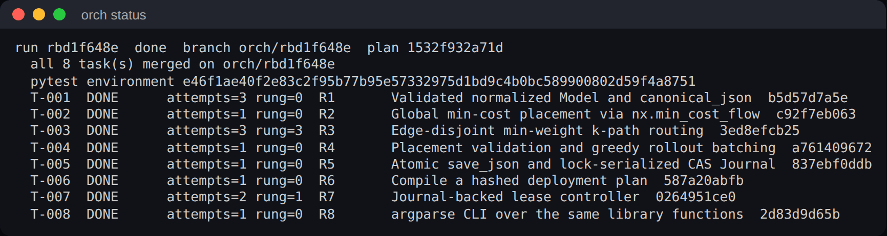
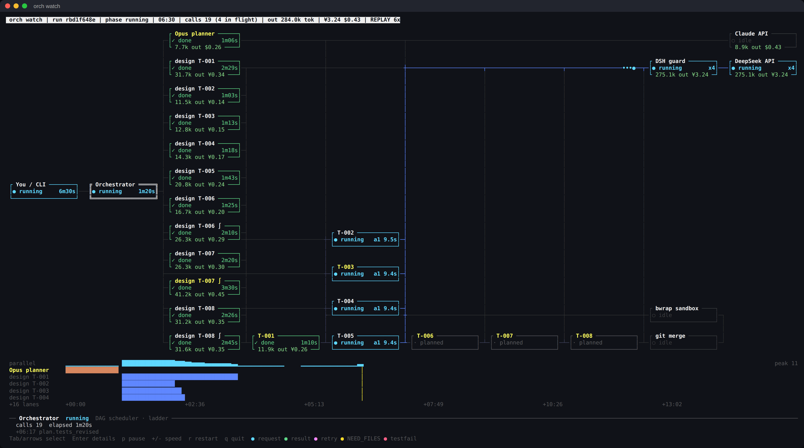
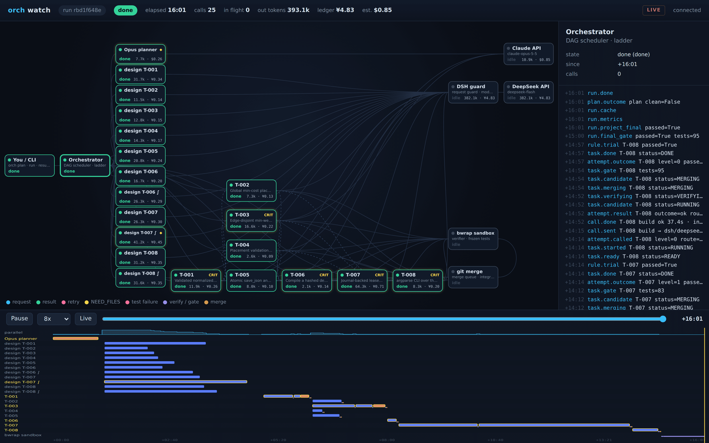
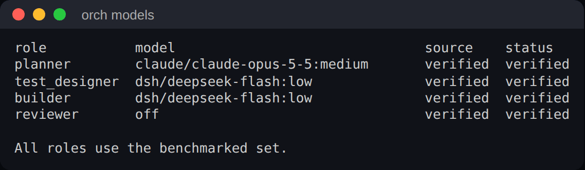

# orch

[English](README.md) · **简体中文**

**为编码智能体打造的测试门控构建编排器，不限语言。** 强模型负责规划，便宜模型并行开发，只有通过冻结测试验证的代码才会进入你的仓库。Go、TypeScript、Rust、Python，或者混合多种语言的仓库都可以。

[](https://github.com/Orchestragent/orchestragent/actions/workflows/ci.yml)
[](LICENSE)




*一次真实 NetworkX（11.6 万行）运行中的 `orch watch`：规划已完成，十个测试分片并行编写，开发节点等待各自的冻结测试。*

## 为什么选 orch

- **只花单个前沿智能体的零头。** 昂贵的模型只做规划，测试和代码由便宜模型并行产出。实测成本约为 high 强度的原生 Claude Opus 5.5 智能体完成同一任务的 **½ 到 ⅕**（[数据见下](#基准测试)）。
- **任何语言，也可以多种混用。** 每个组件用什么语言写、怎么测试，都由模型决定；orch 只保留与语言无关的闸门。一个 Go 服务和它的 TypeScript 客户端可以在同一次运行里一起构建，接口约定的两边都有测试。
- **正确性靠构造，不靠运气。** 每个任务在实现之前就有独立的测试被冻结。只有测试在无网络的系统沙箱中通过，任务才会合并。你当前检出的分支永远不会被改动，你只需审阅一个结果分支。
- **你的模型，你的账号。** 自带 CLI 订阅（Claude Code、Codex、Cursor），或自带 API key（Anthropic、DeepSeek、OpenAI、通义千问、OpenRouter、本地 Ollama，以及任何 OpenAI 兼容接口）。每个角色背后的模型都可以替换。
- **在你工作的地方工作。** 带实时终端视图的 CLI、macOS 应用，以及 [MCP](https://modelcontextprotocol.io) 服务：Claude Code、Codex、Gemini CLI、Cursor、VS Code、Windsurf、opencode、Claude Desktop 都可以把整个多模块构建交给 orch，自己接着干别的。

## 工作原理

1. **规划。** 规划器（默认 Claude Opus 5.5）把需求拆成任务，明确边界、文件归属和接口，接口桩用项目实际使用的语言写。
2. **冻结测试。** 对每个任务、以及每个集成其他任务的任务，由独立的测试设计器（默认 DeepSeek V4.1 Flash）用该组件的测试框架编写测试，并给出运行它们的命令。每个检查必须能跑起来，并且在桩代码上必须失败；各检查合在一起时不能互相干扰。满足这些之后才冻结。
3. **并行开发。** 多个开发节点在隔离的 git worktree 中并发实现任务；所有测试都在系统沙箱中运行（Linux 用 bubblewrap + seccomp，macOS 用 Seatbelt）。
4. **只合并通过的代码。** 任务只有在冻结测试通过后才会合并到 `orch/<run_id>`。失败会沿着修复阶梯逐级处理：带着失败信息重试、多候选采样、更强模型修复、重新规划，而不是从头再来。最后会把所有检查放在一起再跑一遍。
5. **需要时随时介入。** 如果某个任务还是卡住，它会停下来等你：给它一个提示，或者你自己把它完成，运行就会继续（见[下文](#任务卡住时)）。

每一次模型调用、token、缓存命中、花费和状态变化都有记录，因此运行可以恢复、审计（`orch audit`）、从任意一行代码回溯来源（`orch trace`、`orch why`），也可以实时观看（`orch watch`）。

## 安装

```sh
curl -fsSL https://raw.githubusercontent.com/Orchestragent/orchestragent/main/install.sh | sh
```

安装脚本（macOS 和 Linux）会检查 git 和沙箱，安装 [uv](https://astral.sh/uv) 并把 orch 装成独立工具，询问是否保存 DeepSeek key，为检测到的每个智能体应用注册 `orch mcp`（列表见下），在 macOS 上提供安装 Orch.app，最后运行 `orch doctor`。`sh install.sh --dry-run` 可以先查看每一步。

其他方式：

```sh
brew install orchestragent/tap/orchestragent       # macOS，含 zsh/bash/fish 补全
uv tool install "orchestragent[index] @ git+https://github.com/Orchestragent/orchestragent"
```

环境要求：Python 3.12+（orch 本身需要）、git；Linux 上还需要 [bubblewrap](https://github.com/containers/bubblewrap)（`apt install bubblewrap`）。你的项目用到的工具链（Go、Node、Rust、JDK、Python 等）需要已经装好，依赖也要提前装好（`npm ci`、`go mod download`、`cargo fetch` 等）：检查在离线沙箱中运行，沙箱以只读方式看到已安装的工具链（`ORCH_SANDBOX_READ` 可以补充目录）。使用默认模型时需要：已登录的 [Claude Code](https://code.claude.com)（订阅登录 `claude auth login`，或按 Claude Code 文档配置 Anthropic API key），以及 DeepSeek API key（`orch keys dsh`）。其余都是可选的，见[模型](#模型自带-cli-或-key)。

## 快速开始

把需求写成编号的、可测试的陈述，它们是 orch 的权威输入。写清楚放在哪个文件或包里，用什么语言都可以：

```markdown
# spec.md
R1. api/ledger (Go): ParseCSV(r io.Reader) ([]Entry, error) reads date,account,amount_cents,memo
    rows; any invalid row returns an error starting "line N: ".
R2. api/ledger: ExportJSON(entries) returns canonical JSON with sorted balances.
R3. web/src/ledger.ts (TypeScript): parseExport(json) reads exactly what R2 produces and
    throws "invalid ledger: ..." on anything else.
```

```sh
cd your-project                  # 任意至少有一次提交的 git 仓库
orch doctor                      # 模型、key、沙箱是否就绪？
orch plan spec.md                # 规划 + 冻结测试；输出 run id
orch run --notify                # 并行开发、门控合并，结束时发通知
orch watch                       # 另开一个终端：实时观看整个系统
orch cost                        # 按任务和模型统计 token、缓存命中和花费
git diff HEAD...orch/<run_id>    # 审阅结果分支，然后由你自己合并
```



*上面那次 NetworkX 运行结束后的 `orch status`：8 个任务，每个都在冻结测试通过后才合并；其中两个走了修复阶梯（`rung`），全程无需人工介入。*

## 任务卡住时

任务失败时 orch 会自己重试：带着失败信息重试、多生成几个候选、换更强的模型、重新拆分。如果还是过不了，这个任务会被**暂停（parked）**，其余任务照常继续。`orch status` 会显示它失败的检查，以及你可以怎么做：

```sh
orch hint T-005 "金额一律用整数分，不要用浮点数"   # 给之后每次尝试的提示
orch run                                          # T-005 带着你的提示重新尝试

orch take T-005          # 或者自己完成：把它最好的一版代码检出给你
#   ... 只改 T-005 自己的文件；可以运行它打印出来的检查命令 ...
orch submit T-005        # 用冻结测试验证并合并；依赖它的任务接着跑
orch run                 # 运行完成剩下的任务
```

`submit` 只接受对该任务自己文件的修改，并且走和模型代码完全相同的合并闸门；冻结测试不能改。这几步也都是 MCP 工具（`orch_hint`、`orch_take`、`orch_submit`），你的智能体可以替你完成。

## 在你的智能体里使用 orch（MCP）

`orch mcp` 是一个 Model Context Protocol 服务：你的智能体写好需求，把构建交给 orch，自己继续工作，完成后再审阅分支。

```sh
orch mcp --install claude-code      # 或下表中任意一个
```

| 宿主 | `--install` | 注册位置 |
|---|---|---|
| Claude Code | `claude-code` | `claude mcp add`（用户级） |
| Codex CLI | `codex` | `codex mcp add`，并把工具超时设为 660 秒，供 `orch_wait` 使用 |
| Gemini CLI | `gemini` | `~/.gemini/settings.json`（Gemini 只在受信任的文件夹里启动 MCP 服务） |
| Cursor | `cursor` | `~/.cursor/mcp.json` |
| VS Code（Copilot 智能体模式） | `vscode` | 用户级 `mcp.json` |
| Windsurf | `windsurf` | `~/.codeium/windsurf/mcp_config.json` |
| opencode | `opencode` | `~/.config/opencode/opencode.json` |
| Claude Desktop | `claude-desktop` | `claude_desktop_config.json` |

配置文件只合并、不覆盖：其他服务和设置都会保留，原文件会在旁边备份。其他任何 MCP 宿主都可以把 `orch mcp` 作为 stdio 服务来运行。

工具：`orch_start`（后台规划并运行，或继续一个已有的运行）、`orch_wait`、`orch_status`、`orch_report`（结果、分支、diff 统计）、`orch_cost`、`orch_cancel`、`orch_hint`、`orch_take`、`orch_submit`（介入卡住的任务）、`orch_doctor`。

## 实时观看



*同一次运行的第六分钟：所有测试分片已冻结，四个开发节点在 DeepSeek 上并行工作，后续任务等待它们依赖的任务完成。*

- **终端**：`orch watch` 实时绘制整个架构，包括规划器、测试分片、开发节点、模型 API、沙箱和合并门，消息沿连线流动，每条泳道有时间线，花费实时累计。它可以降级到 8 色、单色、ASCII 或纯文本，任何 SSH 会话都能用。`--replay` 回放已完成的运行，`--once` 输出一次快照。
- **macOS**：`orch app install` 安装 **Orch.app**。打开后选择项目，它的实时面板会在浏览器中打开。
- **浏览器**：`orch watch --web`（默认只监听本机；绑定到其他地址时需要 token）。`--export run.html` 导出一个可离线回放、方便分享的独立 HTML 文件。



*已完成运行的浏览器视图：架构图、实时事件日志、可拖动的泳道时间线，以及每个节点的花费。*

## 模型：自带 CLI 或 key

orch 提供架构，模型由你来选。每个角色既可以用你自己订阅登录的 CLI（**BYOC**），也可以用 API key（**BYOK**）：

| 提供方 | 方式 | 类型 |
|---|---|---|
| `claude/<model>:<effort>` | Claude Code：`claude auth login`，或按 Claude Code 文档配置 `ANTHROPIC_API_KEY` / Bedrock / Vertex | BYOC 或 BYOK |
| `codex/<model>:<effort>` | Codex CLI，用你的 ChatGPT 订阅或 key 登录 | BYOC 或 BYOK |
| `cursor/<model>` | Cursor CLI，用你的 Cursor 订阅登录 | BYOC |
| `dsh/deepseek-flash:<effort>` | DeepSeek V4.1 Flash（DSH CLI 或直连 API）：`orch keys dsh` | BYOK |
| `<name>/<model>[:effort]` | 你注册的任意 OpenAI 兼容 API：OpenAI、通义千问、Moonshot、智谱、OpenRouter、本地 Ollama 或 vLLM | BYOK |

```sh
orch providers add openrouter --base-url https://openrouter.ai/api/v1 --key-env OPENROUTER_API_KEY
orch providers add local --base-url http://localhost:11434/v1      # Ollama，无需 key
orch providers test openrouter some/model                           # 发一个很小的真实请求
orch models set builder openrouter/some/model
orch models                                                         # 查看每个角色由谁负责
orch models reset                                                   # 恢复为验证组合
```

**验证组合**就是基准测试所用的配置。想复现我们的结果就直接沿用（抄作业即可），也可以随意替换：

| 角色 | 验证默认值 | 职责 |
|---|---|---|
| planner | `claude/claude-opus-5-5:medium` | 把需求拆成任务、边界和接口 |
| test_designer | `dsh/deepseek-flash:low` | 编写每个任务的冻结测试 |
| builder | `dsh/deepseek-flash:low` | 按冻结测试实现任务 |
| reviewer | `off`（或 `planner`、`opus-low`、`sonnet`、`sonnet-high`、`dsf`） | 可选：冻结前审查每个测试分片 |



其他组合走同一套适配器，但未经验证，质量、速度和成本都可能不同。启用自定义组合时 `orch doctor` 会提示。

**请在服务条款允许的范围内使用各提供方。** 部分消费级订阅不允许自动化或第三方使用，请不要接入这类订阅（orch 会拒绝已知的情况，例如 Kimi 的订阅）。详见 [DISCLAIMER.md](DISCLAIMER.md)。

## 基准测试

验收测试对模型完全隐藏，提供方缓存是冷的，每种配置的输入完全相同。完整数据和日志见 [`docs/measurements`](docs/measurements)；可以用 [`scripts/orch_bench.py`](scripts/orch_bench.py) 和 [`examples/orch-bench`](examples/orch-bench) 里的用例复现。

**同一个仓库里的两种语言**（`polyglot-ledger`：一个 Go 服务加一个 TypeScript 客户端，7 条需求，其中一条要求两边逐字节一致；隐藏验收包括 Go 测试、16 个 vitest 测试和 TypeScript 类型检查）：

| | 验收 | 耗时 | 成本 |
|---|---|---:|---:|
| Claude Opus 5.5（medium），原生智能体 | 通过 | 263 s | $1.02 |
| Claude Opus 5.5（high），原生智能体 | 通过 | 410 s | $1.64 |
| **orch**（验证组合） | 通过 | 584 s | **≈ $0.42** |

下面几张表是用 orch 0.1.0 的旧版（只支持 Python）流程测的，正在用新的不分语言流程重新测量。

**在现有仓库上开发一个中等功能**（Boltons，1.8 万行，8 个隐藏测试；每种配置交错运行 4 次）：

| | 验收 | 耗时（中位数） | 单次成本 |
|---|---:|---:|---:|
| Claude Opus 5.5（high），原生智能体 | 4/4 次通过 | 388 s | $1.42–1.84 |
| **orch**（验证组合） | 4/4 次通过 | 444 s | **≈ $0.50–0.86** |

**更大的功能**（每个 8 个隐藏测试；从需求开始无人值守跑到结束）：

| 场景 | 原生 Opus 5.5 · medium | 原生 Opus 5.5 · high | 原生 Opus 5.5 · max | orch |
|---|---|---|---|---|
| 构建图 + 缓存 + 执行器（Boltons，5 个模块） | – | 8/8 · 778 s · $3.32 | – | **8/8 · 511 s · $0.62** |
| 发布控制器（NetworkX，11.6 万行，8 个模块） | 8/8 · 677 s · $1.94 | 8/8 · 1030 s · $2.72 | 40 分钟内未完成 | 8/8 · 975 s · **$1.54** |
| 时间扩展网络流（NetworkX，9 个强耦合模块） | 8/8 · 632 s · $2.33 | 8/8 · 1078 s · $3.82 | 8/8 · 2219 s · $10.29 | 7/8 · 1022 s · **$1.60** |

orch 目前的水平：它在每个场景都是最便宜的配置；在构建图场景中它也是最快的，成本比 Opus high 低约 5 倍。在 NetworkX 上它还不是最稳的：medium 和 high 的原生 Opus 5.5 每次都全部通过，而 orch 在我们试过的各种配置下 18 次运行中有 6 次 8/8，其余大多漏掉一条隐藏需求，这是我们接下来要解决的问题。提高推理强度对单个智能体也没有帮助：开到 max 时，Opus 耗时是 medium 的 3.5 倍，在时间扩展网络流上成本是 4.4 倍，发布控制器 40 分钟内都没有完成。所有运行（包括失败和无效的）都在 [docs/measurements/2026-11-02-large-projects.md](docs/measurements/2026-11-02-large-projects.md)。

## 内部结构

- `src/orchestragent/orch_run.py`：规划器、测试设计、调度器、修复阶梯、take/submit
- `orch_thin.py`、`orch_generic.py`、`orch_plan.py`：提示词、计划结构、测试分片
- `orch_verify.py`、`orch_sandbox.py`：声明式检查与离线工具链沙箱
- `orch_build.py`、`orch_context.py`、`orch_index.py`：开发上下文与代码索引
- `platform.py`：系统识别、seccomp 过滤、数据目录
- `orch_watch*.py`：实时视图 · `orch_mcp.py`：MCP 服务 · `byok.py`：OpenAI 兼容提供方 · `orch_models.py`：角色 · `orch_cli.py`：命令行

开发：`uv sync && uv run pytest -q && uv run ruff check src tests && uv run mypy`。
设计：[docs/LANGUAGES.md](docs/LANGUAGES.md)（不分语言、闸门、沙箱）；早期设计说明（部分已过时）：[docs/ORCH.md](docs/ORCH.md)。

## 安全

模型只返回 JSON，写文件和执行命令只由 orch 完成。每个检查都在无网络的系统沙箱中运行：只读地看到操作系统、已安装的工具链和项目依赖，只能写自己的工作目录和一个临时 home；看不到你的主目录、凭据存储和 orch 自己的数据目录。Key 只保存在你的机器上（macOS 钥匙串或权限 0600 的文件），从不写入日志。orch 自身不设花费上限：花费会被记录并通过 `orch cost` 展示，额度由你的提供方余额或限额决定。详见 [SECURITY.md](SECURITY.md)。

## 许可证

Apache-2.0（[LICENSE](LICENSE)）。通过 orch 使用模型提供方须遵守其各自条款，详见 [DISCLAIMER.md](DISCLAIMER.md)。
