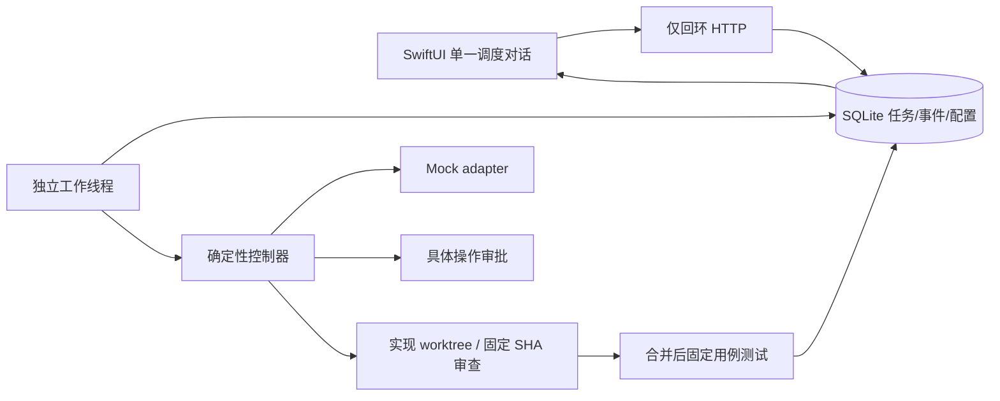

# 架构与阶段验收

> 本文记录初始 Mock 基线；当前真实 Mac 执行增量以 [LIVE_CONTRACT.md](LIVE_CONTRACT.md) 为准。

## 数据流

客户端从任务 ID 与单调递增事件序列恢复轮询，不需要保持 WebSocket 连接。
任务请求 ID 具有唯一约束，相同 ID 和内容返回原任务，改变内容返回冲突。
客户端在发送前保存待提交请求；未知网络结果可使用原 ID 重试。

模型适配器只返回结果与建议状态，没有调用用户批准接口的权限。
队列将领取任务、持久状态及审计事件放在事务中。每次领取创建不同 run_token；
取消、暂停、超时或重启恢复会使旧 token 失效，迟到结果不能覆盖控制状态。
单服务实例锁防止另一个进程错误恢复活跃任务。配置通过版本比较避免覆盖并发修改。

## 状态与恢复

| 状态 | 自动行为 | 用户操作 |
| --- | --- | --- |
| queued / running | 按依赖推进固定阶段 | 暂停、取消 |
| rate_limited | 等 next_run_at 后重试同一 Mock 执行端 | 暂停、取消；恢复也不绕过窗口 |
| waiting_approval | 停止 | 批准具体摘要、拒绝、取消 |
| quota_exhausted / auth_required | 不自动重试或换账单路线 | 处理原因后显式恢复，或取消 |
| timed_out | 使过期运行 token 失效 | 显式恢复或取消 |
| paused | 不执行下一阶段 | 恢复或取消 |
| failed / cancelled / completed | 终态 | 查看结果；新需求使用新请求 ID |

进程重启只重排未完成的 **Mock** 阶段；不会重做已记录完成的阶段。
固定 Mock 文件写入、提交、worktree 创建和 fast-forward 集成允许幂等重放。
测试覆盖 Git 已提交但数据库尚未 checkpoint 的故障间隙。
审批等待和暂停在重启后保持原状态；审批 ID、操作摘要、版本必须匹配。

暂停／取消是协作式的：阻止后续阶段并拒收旧结果，已经开始的短暂本地 Git 操作
可能先完成，所留工件保留以供检查，不承诺回滚已有文件或杀死任意进程。
看门狗在 HTTP 主循环检查租约；Mock 子进程另有超时。真实厂商进程树终止、
检查点恢复与安全沙箱尚未实现，禁用适配器不可绕过这些缺项。

## 隔离与授权

每个 Mock 任务创建自己的本地 Git 仓库，实现任务使用自己的分支/worktree，
审查使用 detached worktree 与精确 SHA，集成目标必须等于被审查 SHA。
Git 子进程使用最小环境、禁用全局配置和 hooks；固定示例代码先做 AST 白名单检查。
测试只执行已知 arithmetic fixture。HTTP 不提供任意 shell、文件路径或 provider 启用接口。

Worktree 不是安全沙箱。本版本的威胁模型仅为用户自己运行的本机 Mock 演示：
回环绑定、严格 Host、拒绝 Origin 与请求体限制减少网页误调用，不能替代身份认证。
审批的 actor=user 表示控制接口发来的操作，而非经过密码学验证的用户身份。
持久配对凭据、TLS、独立 OS 用户／容器权限、网络出口、进程与磁盘限额需要
设计并确认后才能接真实 iPhone／Linux 主机。没有读取或挂载用户 HOME、SSH agent、
厂商凭据，也没有注册启动服务。客户端设置禁止输入授权字段，指令文本不能改变权限。

SQLite 保存用户主动提交的任务文本与设置；不要把密钥作为任务内容提交。
日志不记录 HTTP 请求正文或任意异常消息；Mock 结果与事件不会包含环境变量。
真实厂商输出脱敏和账单核对必须随适配器一起验证。

## 交付边界与后续顺序

本轮交付：持久队列与事件、Mock 全闭环、Codex/Claude 禁用骨架、原生 iOS
提交／历史／状态／审批／取消／暂停／重连、版本化调度偏好与一句话 Mock 草案。

1. 确认目标账号实际模型与订阅适用方式，先实现一个 Codex 官方协议 adapter，
   并用脱敏协议录制样本测试事件、错误分类和恢复，再请求一次具体真实任务授权。
2. 实现真实执行的权限与进程隔离、账单来源校验、配额上限、人工批准和审计。
   不能因设置中选择模型而直接启用它；无自动 API 回退。
3. 加 Claude 原生 CLI 适配；核实环境认证优先级和订阅允许的使用范围。
4. 实现经过 schema 校验的模型计划、动态依赖图、并行任务与配置语义草案。
   不允许模型修改不可变权限，审查／集成保持固定提交。
5. 用户确认后配置设备配对与 TLS，再测试真机锁屏／重连，最后评估 Linux 部署。
6. DSH/API 额度先确认 500 元含义及消费授权。Cursor 和 Kimi 分别按其真实权限接入；
   Kimi 订阅的无人值守方式在当前规则下排除。

第一版不含推送、语音、快捷指令、分布式队列、真实多厂商联调或生产部署。
